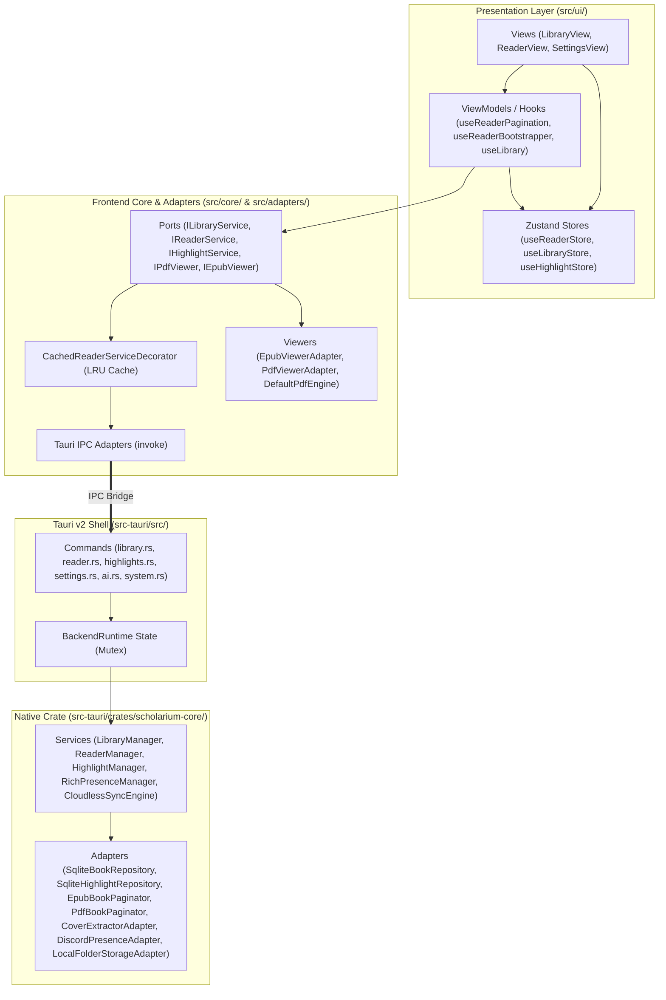

# 02. Software Architecture & Directory Structure

## 1. Architectural Principles & Rust vs. TypeScript Division (Backend-Heavy)

The project uses **Clean Architecture / Hexagonal Architecture (Ports & Adapters)** combined with a **Backend-Heavy Rust** core and a **Reactive MVVC Frontend** to ensure low memory usage and a 60fps UI:

- **Native Rust Core (`src-tauri/crates/scholarium-core/`):**
  - Isolated as a pure library crate (with no direct WebKit/window dependencies, allowing `cargo test` and `cargo clippy` to run standalone).
  - Houses domain entities (`BookMetadata`, `BookStorageLocation`, `Highlight`, `RichAnnotation`), port traits (`BookRepository`, `HighlightRepository`, `BookPaginator`, `BookCoverExtractor`, `StorageProvider`, `ConfigurationStore`, `PlatformEnvironment`, `ExportStrategy`, `LlmProvider`, `PresenceProvider`, `TtsProvider`, `SystemBridge`), and application services (`LibraryManager`, `ReaderManager`, `HighlightManager`, `Sha256BookHasher`, `DataPortabilityService`, `CloudlessSyncEngine`, `PromptBuilder`, `RichPresenceManager`, `TtsSessionManager`).
  - Contains concrete adapters for SQLite persistence (with SQL queries isolated in `*_queries.rs` files), EPUB/PDF pagination, cover extraction, OS platform environments (`LinuxEnvironment`, `WindowsEnvironment`, `AndroidEnvironment`, `IosEnvironment`), Discord IPC, and local/cached storage.
- **Modular Tauri v2 Shell (`src-tauri/src/`):**
  - Organized into dedicated modules: `bootstrap.rs` (app initialization and command registration), `state.rs` (`BackendRuntime`), `dtos.rs` (serializable transport structs), `seed.rs` (default book seeding), `utils.rs`, and `commands/` (`library.rs`, `reader.rs`, `highlights.rs`, `settings.rs`, `ai.rs`, `system.rs`).
- **TypeScript Domain, Ports & WebView Adapters (`src/core/` and `src/adapters/`):**
  - `src/core/domain/`: Entities and value objects (`BookMetadata`, `Highlight`, `RichAnnotation`, `PageWindow`, `types`).
  - `src/core/ports/`: IPC service contracts (`ILibraryService`, `IReaderService`, `IHighlightService`, `IPresenceService`, `ISettingsService`) and document viewer contracts (`IDocumentViewer`, `IEpubViewer`, `IPdfViewer`, `IPdfEngine`, `IDocumentViewerFactory`).
  - `src/core/utils/`: Pure support data structures (`LruCache`).
  - `src/adapters/ipc/`: Modular Tauri `invoke()` clients and `CachedReaderServiceDecorator` (in-memory LRU cache for binaries and page chunks).
  - `src/adapters/viewers/`: `EpubViewerAdapter`, `PdfViewerAdapter`, and `DefaultPdfEngine`.
- **Frontend UI — MVVC Pattern with Zustand (`src/ui/` and `src/utils/`):**
  - `src/ui/providers/`: Dependency injection (`ServiceContainerContext`), theme (`ThemeContext`), and navigation (`NavigationContext`).
  - `src/ui/stores/`: Atomic Zustand stores (`useLibraryStore`, `useReaderStore`, `useReaderUIStore`, `useHighlightStore`, `useTypographyStore`) consumed via granular selectors to prevent cascading re-renders.
  - `src/ui/hooks/`: Modular ViewModels / Controllers (`useLibrary`, `useReaderBootstrapper`, `useReaderPagination`, `useReaderHighlights`, `usePdfPageRenderer`, `useReaderZoomGestures`, `useSystemHandler`, etc.).
  - `src/ui/components/ui/`: Atomic Design System (`Button`, `IconButton`, `Card`, `Badge`, `Input`, `Textarea`, `Modal`, `Dialog`, `Popover`, `DropdownMenu`, `SegmentedControl`, `TagInput`, `ColorPicker`, `ProgressBar`, `EmptyState`, `PassageQuote`, `AutocompleteInput`).
  - `src/ui/components/`: Domain components grouped by context (`library/`, `reader/`, `settings/`).
  - `src/utils/`: Pure frontend utilities (`dom`, `domSelection`, `fileReader`, `markdownFormatting`, `math`, `pdfCoordinates`, `pdfCoverGenerator`, `readerTokenizer`).

---

## 2. Directory Structure

```text
├── src-tauri/
│   ├── crates/
│   │   └── scholarium-core/
│   │       ├── src/
│   │       │   ├── core/
│   │       │   │   ├── domain/           # types.rs, book_metadata.rs, book_storage_location.rs, rich_annotation.rs, highlight.rs
│   │       │   │   ├── ports/            # book_repository.rs, repository.rs, book_paginator.rs, book_cover_extractor.rs, storage_provider.rs, configuration_store.rs, platform_environment.rs, export_strategy.rs, llm_provider.rs, presence_provider.rs, tts_provider.rs, system_bridge.rs
│   │       │   │   └── services/         # sha256_book_hasher.rs, library_manager.rs, reader_manager.rs, highlight_manager.rs, data_portability_service.rs, cloudless_sync_engine.rs, prompt_builder.rs, rich_presence_manager.rs, tts_session_manager.rs
│   │       │   ├── adapters/
│   │       │   │   ├── configuration/    # sqlite_configuration_store.rs, sqlite_configuration_queries.rs
│   │       │   │   ├── extractor/        # cover_extractor_adapter.rs, epub_cover_extractor.rs, pdf_cover_extractor.rs
│   │       │   │   ├── pagination/       # epub_book_paginator.rs, pdf_book_paginator.rs
│   │       │   │   ├── persistence/      # sqlite_book_repository.rs, sqlite_book_queries.rs, sqlite_highlight_repository.rs, sqlite_highlight_queries.rs
│   │       │   │   ├── platform/         # linux_environment.rs, windows_environment.rs, android_environment.rs, ios_environment.rs
│   │       │   │   ├── presence/         # discord_presence_adapter.rs, discord_presence_client.rs
│   │       │   │   └── storage/          # local_folder_storage_adapter.rs, cached_storage_decorator.rs
│   │       │   └── lib.rs
│   │       └── tests/                    # Unit and integration test suites for scholarium-core
│   │           ├── fakes/mod.rs
│   │           ├── cached_storage_and_presence_spec.rs
│   │           ├── cloudless_sync_and_portability_spec.rs
│   │           ├── cover_extractor_spec.rs
│   │           ├── discord_presence_spec.rs
│   │           ├── highlight_spec.rs
│   │           ├── library_and_sqlite_spec.rs
│   │           ├── platform_and_config_spec.rs
│   │           ├── reader_and_paginator_spec.rs
│   │           ├── sha256_book_hasher_spec.rs
│   │           ├── sqlite_book_repository_spec.rs
│   │           └── tts_and_system_bridge_spec.rs
│   └── src/                              # Tauri v2 application shell and IPC layer
│       ├── commands/                     # library.rs, reader.rs, highlights.rs, settings.rs, ai.rs, system.rs
│       ├── bootstrap.rs
│       ├── dtos.rs
│       ├── lib.rs
│       ├── main.rs
│       ├── seed.rs
│       ├── state.rs
│       └── utils.rs
├── src/
│   ├── core/
│   │   ├── domain/                       # types.ts, BookMetadata.ts, Highlight.ts, RichAnnotation.ts, PageWindow.ts
│   │   ├── ports/                        # ILibraryService.ts, IReaderService.ts, IHighlightService.ts, IPresenceService.ts, ISettingsService.ts, IDocumentViewer.ts, IEpubViewer.ts, IPdfViewer.ts, IPdfEngine.ts, IDocumentViewerFactory.ts
│   │   └── utils/                        # lruCache.ts
│   ├── adapters/
│   │   ├── ipc/                          # TauriLibraryService.ts, TauriReaderService.ts, CachedReaderServiceDecorator.ts, TauriHighlightService.ts, TauriPresenceService.ts, TauriSettingsService.ts
│   │   └── viewers/                      # EpubViewerAdapter.ts, PdfViewerAdapter.ts, DefaultPdfEngine.ts
│   ├── ui/
│   │   ├── providers/                    # ServiceContainerContext.tsx, ThemeContext.tsx, NavigationContext.tsx
│   │   ├── stores/                       # useLibraryStore.ts, useReaderStore.ts, useReaderUIStore.ts, useHighlightStore.ts, useTypographyStore.ts
│   │   ├── hooks/                        # Custom Hooks / Controllers (useLibrary, useReaderBootstrapper, useReaderPagination, etc.)
│   │   ├── components/
│   │   │   ├── ui/                       # Atomic Design System
│   │   │   ├── library/                  # Library, Collections, and Annotations components
│   │   │   ├── reader/                   # Reader components (ReaderStream, ReaderPageItem, ReaderPagePdf, PdfHighlightLayer, etc.)
│   │   │   ├── settings/                 # Settings sections
│   │   │   ├── LibraryView.tsx
│   │   │   ├── ReaderView.tsx
│   │   │   └── SettingsView.tsx
│   │   ├── App.tsx
│   │   ├── main.tsx
│   │   └── styles.css
│   ├── utils/                            # Pure functions (dom.ts, domSelection.ts, fileReader.ts, markdownFormatting.ts, math.ts, pdfCoordinates.ts, pdfCoverGenerator.ts, readerTokenizer.ts)
│   └── test/                             # Vitest test suite mirroring src/
```

---

## 3. Mandatory Path Aliases (`tsconfig.json` & `vite.config.ts`)

To keep imports clean and decoupled from relative folder depth, use the configured path aliases:
- `@domain` / `@domain/*` -> `src/core/domain/*`
- `@ports` / `@ports/*` -> `src/core/ports/*`
- `@core/utils` / `@core/*` -> `src/core/*`
- `@adapters` / `@adapters/*` -> `src/adapters/*`
- `@providers/*` -> `src/ui/providers/*`
- `@stores/*` -> `src/ui/stores/*`
- `@hooks/*` -> `src/ui/hooks/*`
- `@components/*` -> `src/ui/components/*`
- `@ui` / `@ui/*` -> `src/ui/components/ui/index.ts` / `src/ui/*`
- `@utils` / `@utils/*` -> `src/utils/*`

---

## 4. Architecture Diagram (Mermaid UML)



---

## 5. Reader Pagination & Stream Architecture

1. **Decoupled Bootstrap (`useReaderBootstrapper`):**
   - When opening a book, resolves the binary via `IReaderService` (decorated by `CachedReaderServiceDecorator`), initializes the matching viewer (`EpubViewerAdapter` or `PdfViewerAdapter`), and loads the initial page window centered around the saved page (`calculatePageWindow`).
   - For PDFs without an existing cover, asynchronously renders page 1 via `pdfCoverGenerator` and persists the cover in the backend without blocking reader startup.
2. **$O(1)$ Indexed Page Map (`LoadedPagesInfo` in `useReaderStore`):**
   - Loaded pages are stored in a `Map<number, DocumentPage>` (`byPage`) alongside `minPage` and `maxPage` bounds, enabling constant-time $O(1)$ lookups when rendering `ReaderStream` (including checking chapter title transitions between `pageNumber - 1` and `pageNumber`).
3. **Focal Detection & Presence Synchronization (`useReaderPagination`):**
   - The 60fps scroll listener (`requestAnimationFrame`) collects only rendered `<article data-page-number>` elements (`rect.height > 0`), identifying the page crossing the focal reading line (35% of viewport height) and computing its `offsetRatio`.
   - Rich Presence is dispatched when the focal page changes (`detected.pageNumber !== lastPresencePageRef.current`) or on direct jumps (`goToPage`), avoiding duplicate calls (`actual === last`).
