# 02. Software Architecture & Directory Structure

## 1. Princípios Arquiteturais e Divisão Rust vs. TypeScript (Backend-Heavy)

O projeto utiliza **Clean Architecture / Hexagonal Architecture (Ports & Adapters)** combinada com uma estratégia **Backend-Heavy em Rust** para garantir baixo consumo de memória (essencial no iOS `WKWebView`) e UI a 60fps:

- **Core Nativo em Rust (`src-tauri/crates/ipdf-core/`):**
  - Isolado como uma crate pura (sem dependência direta de janelas/WebKit, permitindo rodar `cargo test` e `cargo clippy` instantaneamente em qualquer ambiente).
  - Concentra o domínio (`Highlight`, `BookMetadata`, `RichAnnotation`), as traits de portas (`HighlightRepository`, `StorageProvider`, `ExportStrategy`, `PresenceProvider`), o cálculo de hash SHA-256 em *streaming* de 64 KB (`Sha256BookHasher`), o gerenciamento de biblioteca baseado em arquivos e storage (`LibraryManager`), o merge *Last-Write-Wins* (`DataPortabilityService`), o `CloudlessSyncEngine`, o `CachedStorageDecorator`, o `PromptBuilder` e o `RichPresenceManager`.
- **Shell Tauri v2 (`src-tauri/src/`):**
  - Expõe comandos IPC (`#[tauri::command]`) conectando a WebView à crate `ipdf-core` e aos plugins/recursos do sistema operacional.
- **Domínio, Portas e Adaptadores de WebView em TypeScript (`src/core/` e `src/adapters/`):**
  - Focados nas responsabilidades que vivem no DOM/Canvas da WebView: renderização de documentos (`IDocumentViewer`: `EpubViewerAdapter`, `PdfViewerAdapter`) e estratégias de edição visual/formatação assistida (`IAnnotationToolStrategy`: `AssistedRichTextStrategy`, `TldrawAnnotationStrategy`, `DrawioAnnotationStrategy` com *Command Dispatch Maps*), além de espelhos leves para modo de bancada/testes.
- **Frontend UI — Padrão MVVC / MVVM (`src/ui/`):**
  - `src/ui/providers/`: *Composition Root* e provedores React Context (`ServiceContainerContext.tsx`) responsáveis exclusivamente pela Inversão de Controle (DI).
  - `src/ui/hooks/`: *ViewModels / ViewControllers* implementados como Custom Hooks (`useStudyWorkbenchViewModel.ts`), encapsulando todo o estado de tela.
  - `src/ui/components/`: Componentes visuais puramente declarativos, modulares e reutilizáveis (`PassageReaderPanel`, `SectionAnnotationPanel`, `AssistedFormattingToolbar`, `HighlightCard`, `CodeInspectorBox`).
- **Testes e Dublês (`src/test/` no TypeScript + `src-tauri/crates/ipdf-core/tests/` no Rust):**
  - No TypeScript, todos os arquivos `*.spec.ts` ficam na pasta `src/test/` espelhando os módulos de `src/`.
  - No Rust, os testes de integração e unidade ficam em `src-tauri/crates/ipdf-core/tests/`.

---

## 2. Estrutura de Diretórios Obrigatória

```text
├── src-tauri/
│   ├── crates/
│   │   └── ipdf-core/                    # Crate Rust pura modularizada (espelhando a arquitetura Hexagonal)
│   │       ├── src/
│   │       │   ├── core/
│   │       │   │   ├── domain/           # types.rs, book_metadata.rs, rich_annotation.rs, highlight.rs
│   │       │   │   ├── ports/            # repository.rs, storage_provider.rs, export_strategy.rs, llm_provider.rs, presence_provider.rs, tts_provider.rs, system_bridge.rs
│   │       │   │   └── services/         # sha256_book_hasher.rs, highlight_manager.rs, data_portability_service.rs, cloudless_sync_engine.rs, prompt_builder.rs, rich_presence_manager.rs, tts_session_manager.rs
│   │       │   ├── adapters/
│   │       │   │   └── storage/          # cached_storage_decorator.rs
│   │       │   └── lib.rs
│   │       └── tests/                    # Suíte de testes Rust modularizada
│   │           ├── fakes/                # mod.rs (InMemoryHighlightRepo, InMemoryStorage, SpyPresence, SpyTtsProvider, SpyMediaControls, SpyPowerBlocker)
│   │           ├── highlight_spec.rs
│   │           ├── sha256_book_hasher_spec.rs
│   │           ├── cloudless_sync_and_portability_spec.rs
│   │           ├── cached_storage_and_presence_spec.rs
│   │           └── tts_and_system_bridge_spec.rs
│   └── src/
│       └── lib.rs                        # Comandos IPC Tauri (#[tauri::command]) expondo o ipdf-core
├── src/
│   ├── core/
│   │   ├── domain/
│   │   │   ├── types.ts                  # Value Objects (BoundingBox, HighlightAnchor, AnnotationCommand, etc.)
│   │   │   ├── Highlight.ts              # Entidade/DTO Highlight para colisão e formatação a 60fps na UI
│   │   │   ├── RichAnnotation.ts         # Discriminated Unions de anotações (AssistedText, Tldraw, Drawio) + FormatterMap
│   │   │   └── BookMetadata.ts           # Estrutura de metadados do livro
│   │   ├── ports/
│   │   │   ├── BackendService.ts         # Porta de serviços unificada conectando o Frontend ao ipdf-core em Rust
│   │   │   ├── IDocumentViewer.ts        # Contrato de renderização DOM/Canvas (EPUB/PDF)
│   │   │   └── IAnnotationStrategy.ts    # Contratos Strategy para editores visuais a 60fps (Texto Assistido, tldraw, draw.io)
│   │   └── services/
│   │       └── AnnotationWorkbenchService.ts # Orquestrador de edição 60fps (Command Dispatch + Formatters) persistindo via BackendService
│   ├── adapters/
│   │   ├── ipc/
│   │   │   └── TauriBackend.ts           # Implementação de BackendService via Tauri invoke()
│   │   └── annotations/                  # AssistedRichTextStrategy.ts, DiagramAnnotationStrategies.ts
│   ├── ui/                               # Camada de Apresentação em Arquitetura MVVC
│   │   ├── providers/                    # IoC / Injeção de Dependências e Tema (ServiceContainerContext.tsx, ThemeContext.tsx)
│   │   ├── hooks/                        # ViewModels / ViewControllers (Custom Hooks)
│   │   ├── components/                   # Telas e painéis visuais de alto nível
│   │   │   └── ui/                       # Componentes atômicos do Design System (Button, Card, Badge, Input, Modal, Popover)
│   │   └── App.tsx                       # Composição declarativa de alto nível
│   └── test/                             # Testes TypeScript/UI espelhando a estrutura de src/
│       ├── core/
│       │   ├── domain/                   # Highlight.spec.ts
│       │   └── services/                 # AnnotationWorkbenchService.spec.ts
│       ├── adapters/
│       │   └── ipc/                      # TauriBackend.spec.ts
│       └── mocks/                        # MockBackend.ts
```

---

## 3. Diagrama de Classes Global (Mermaid UML)

```mermaid
classDiagram
    class ReaderController {
        -IDocumentViewer viewer
        -HighlightManager highlightManager
        -LibraryManager libraryManager
        -ContextualAssistant assistant
        -ITTSProvider tts
        -SystemBridge systemBridge
        -RichPresenceManager presenceManager
        -CloudlessSyncEngine syncEngine
        +openBook(bookHash: string) Promise~void~
        +onPageTurned(pageInfo: PageInfo) void
        +highlightSelection(color: string, note?: string) Promise~Highlight~
        +explainOrTranslateSelection(mode: AssistantMode) Promise~void~
    }

    class IDocumentViewer {
        <<interface>>
        +render(container: HTMLElement, fileData: ArrayBuffer) Promise~void~
        +destroy() void
        +goToPage(target: number | string) Promise~void~
        +nextPage() Promise~void~
        +prevPage() Promise~void~
        +getCurrentPage() PageInfo
        +getSelection() TextSelection
        +clearSelection() void
        +renderHighlights(highlights: Highlight[]) void
        +eraseHighlightFromDOM(highlightId: string) void
        +injectInlineAnnotation(anchor: HighlightAnchor, shortText: string, tooltipDetails?: string) void
        +extractVisibleSentences() Promise~SentenceNode[]~
        +setActiveTTSSentence(sentenceId: string) void
    }

    class HighlightManager {
        -IHighlightRepository repository
        -Map~string, Highlight~ cache
        -Map~RichAnnotationType, IAnnotationToolStrategy~ strategies
        +registerStrategy(strategy: IAnnotationToolStrategy) void
        +loadBookHighlights(bookHash: string) Promise~Highlight[]~
        +createFromSelection(bookHash: string, sel: TextSelection, color: string, note?: string) Promise~Highlight~
        +interactWithAnnotation(highlightId: string, type: RichAnnotationType, action: AnnotationCommand) Promise~Highlight~
        +formatHighlightAnnotations~R~(highlightId: string, formatterMap: AnnotationFormatterMap~R~) R[]
        +getForPage(pageNumber: number) Highlight[]
    }

    class IAnnotationToolStrategy {
        <<interface>>
        +readonly type: RichAnnotationType
        +applyToHighlight(highlight: Highlight, command: AnnotationCommand) Promise~void~
        +serialize(annotation: IRichAnnotation) string
        +deserialize(rawData: string, updatedAt: Date) IRichAnnotation
    }

    class DataPortabilityService {
        -IHighlightRepository highlightRepo
        -IStorageProvider storage
        +exportData(options: ExportOptions, strategy: IExportStrategy) Promise~Uint8Array | string~
        +importData(raw: Uint8Array | string, strategy: IExportStrategy, rule: ConflictResolution) Promise~ImportReport~
    }

    class CloudlessSyncEngine {
        -IStorageProvider storage
        -DataPortabilityService portabilityService
        +syncBookState(bookHash: string) Promise~void~
        +syncLibraryIndex() Promise~void~
    }

    class IStorageProvider {
        <<interface>>
        +readonly providerId: string
        +initialize() Promise~boolean~
        +isAvailable() boolean
        +hasBookBinary(bookHash: string) Promise~boolean~
        +readBookBinary(bookHash: string, onProgress?: Function) Promise~ArrayBuffer~
        +writeBookBinary(bookHash: string, data: ArrayBuffer, format: BookFormat) Promise~void~
        +listEntries(prefix?: string) Promise~StorageEntry[]~
        +readEntry(name: string) Promise~Uint8Array | null~
        +writeEntry(name: string, data: Uint8Array | string, mimeType?: string) Promise~StorageEntry~
    }

    class ContextualAssistant {
        -ILLMProvider llmProvider
        -PromptBuilder promptBuilder
        +lookupTerm(ctx: ReadingContext, targetLang: string) Promise~TermDefinition~
        +translateInPlace(ctx: ReadingContext, targetLang: string) Promise~TranslationResult~
        +explainPassage(ctx: ReadingContext, onChunk: Function, question?: string) Promise~string~
    }

    class RichPresenceManager {
        -Map~string, IPresenceProvider~ providers
        +registerProvider(provider: IPresenceProvider) void
        +updateActivity(activity: ReadingActivity, immediate?: boolean) void
        +clearAllPresence() Promise~void~
    }

    class SystemBridge {
        +readonly notifications: INotificationService
        +readonly mediaSession: IMediaControlService
        +readonly power: IPowerSaveBlocker
        +readonly clipboard: IClipboardService
    }

    ReaderController --> IDocumentViewer
    ReaderController --> HighlightManager
    HighlightManager --> IAnnotationToolStrategy
    ReaderController --> ContextualAssistant
    ReaderController --> SystemBridge
    ReaderController --> RichPresenceManager
    ReaderController --> CloudlessSyncEngine
    CloudlessSyncEngine --> DataPortabilityService
    CloudlessSyncEngine --> IStorageProvider
    DataPortabilityService --> IStorageProvider
```



---

## 4. Abstração Unificada de Storage (`IStorageProvider` + Decorator Pattern)

O Core (`ReaderController`, `LibraryManager`, `DataPortabilityService`, `CloudlessSyncEngine`) conversa exclusivamente com a porta `IStorageProvider`, sem saber qual adaptador está por trás:

- **`StandaloneFileStorageAdapter`:** Mapeia arquivos `.epub`/`.pdf` avulsos abertos pelo usuário a partir de qualquer caminho do sistema de arquivos ao seu `bookHash` SHA-256.
- **`LocalFolderStorageAdapter`:** Lê e grava diretamente em uma pasta local do dispositivo (ou pasta sincronizada por Syncthing/iCloud/Dropbox).
- **`GoogleDriveStorageAdapter`:** Implementa a mesma interface sobre a API do Google Drive.
- **`CachedStorageDecorator` (`implements IStorageProvider`):** Envolve um `localCache: IStorageProvider` e um `primaryStorage: IStorageProvider`, realizando cache local sob demanda (*On-Demand Caching*) e fallback offline de forma 100% transparente.

Estrutura lógica de entradas mantida pelo `IStorageProvider`:

```text
📁 Storage Root (Local Folder, App Data ou Google Drive)
 ├── 📄 .reader_library_index.json       # Catálogo leve com metadados, capas e página atual
 ├── 📁 books/
 │    └── 📕 <bookHash>.epub | .pdf      # Binários completos acessados por bookHash
 └── 📁 highlights/
      └── 📄 <bookHash>.highlights.json  # Grifos e notas isolados por livro para merge rápido (LWW)
```

### Fluxo de Sincronização (Last-Write-Wins)
1. **Verificação de Autenticação:** Se `remoteStorage.isAuthenticated()` retornar `false`, o `CloudlessSyncEngine` ignora silenciosamente a operação sem lançar erro (garantindo operação *Offline-First*).
2. **Sincronização de Grifos por Livro (`syncBookState`):**
   - Localiza `<bookHash>.highlights.json` na pasta remota.
   - Caso exista, baixa o payload e delega ao `DataPortabilityService.importData(..., 'last-write-wins')` para mesclar os grifos remotos com os locais baseando-se em `updatedAt`.
   - Exporta o estado consolidado do livro via `DataPortabilityService.exportData` (`includeBookFiles: false`, formato `json-only`) e faz upload de `<bookHash>.highlights.json`.
3. **Sincronização do Catálogo (`syncLibraryIndex`):**
   - Mescla `.reader_library_index.json` contendo os metadados (`BookMetadata`) e progresso de leitura (`currentPage`, `percentage`, `updatedAt`) entre dispositivos.
