# 02. Software Architecture & Directory Structure

## 1. Princípios Arquiteturais

O projeto utiliza **Clean Architecture / Hexagonal Architecture (Ports & Adapters)** com forte orientação a objetos e Injeção de Dependência (DI) via construtor:

- **Domínio (`src/core/domain/`):** Entidades puras e objetos de valor (`Highlight`, `BookMetadata`, `BoundingBox`, `HighlightAnchor`, `PageInfo`, `TextSelection`, `SentenceNode`). Zero dependências de frameworks, DOM específico de terceiros, UI ou banco de dados.
- **Portas (`src/core/ports/`):** Interfaces TypeScript estritas que definem os contratos de entrada e saída (`IDocumentViewer`, `IRepository`, `IHighlightRepository`, `ITTSProvider`, `ILLMProvider`, `IPresenceProvider`, `IRemoteStorageProvider`, `ISystemBridge`).
- **Serviços de Aplicação (`src/core/services/`):** Orquestradores de casos de uso (`ReaderController`, `HighlightManager`, `LibraryManager`, `ContextualAssistant`, `PromptBuilder`, `DataPortabilityService`, `RichPresenceManager`, `CloudlessSyncEngine`, `SystemBridge`). Dependem exclusivamente das entidades de `domain/` e interfaces em `ports/`.
- **Adaptadores (`src/adapters/`):** Implementações concretas (`EpubViewerAdapter`, `PdfViewerAdapter`, `SQLiteHighlightRepository`, `OllamaLocalLLMProvider`, `CloudAPILLMProvider`, `GoogleDriveStorageProvider`, `DiscordIPCProvider`, `CustomWebhookProvider`, `PiperLocalTTS`, `NativeSystemTTS`).
- **Frontend UI — Padrão MVVC / MVVM (`src/ui/`):**
  - `src/ui/providers/`: *Composition Root* e provedores React Context (`ServiceContainerContext.tsx`) responsáveis exclusivamente pela Inversão de Controle (DI).
  - `src/ui/hooks/`: *ViewModels / ViewControllers* implementados como Custom Hooks (`useStudyWorkbenchViewModel.ts`), encapsulando todo o estado de tela e invocação dos serviços do Core.
  - `src/ui/components/`: Componentes visuais puramente declarativos, modulares e reutilizáveis (`PassageReaderPanel`, `SectionAnnotationPanel`, `AssistedFormattingToolbar`, `HighlightCard`, `CodeInspectorBox`), sem lógica de negócio ou instanciação de serviços.
- **Testes e Dublês (`test/` na raiz):** Todos os arquivos `*.spec.ts` ficam fora de `src/`, na pasta raiz `test/` espelhando exatamente a árvore de `src/` (`test/core/domain/`, `test/core/services/`, `test/adapters/`), junto com `test/fakes/` (*In-Memory*, *Mocks* e *Spies*).

---

## 2. Estrutura de Diretórios Obrigatória

```text
├── src/
│   ├── core/
│   │   ├── domain/
│   │   │   ├── types.ts                  # Value Objects (BoundingBox, HighlightAnchor, PageInfo, etc.)
│   │   │   ├── Highlight.ts              # Entidade rica Highlight com regras de negócio, colisão e suporte a Visitor
│   │   │   ├── RichAnnotation.ts         # Hierarquia polimórfica de anotações (AssistedText, Tldraw, Drawio) + Visitor
│   │   │   └── BookMetadata.ts           # Estrutura e tipos de metadados do livro
│   │   ├── ports/
│   │   │   ├── IDocumentViewer.ts        # Contrato de renderização (EPUB/PDF)
│   │   │   ├── IAnnotationStrategy.ts    # Contratos Strategy + Visitor para editores de anotação (Texto Assistido, tldraw, draw.io)
│   │   │   ├── IRepository.ts            # Contratos genéricos e específicos de persistência
│   │   │   ├── ITTSProvider.ts           # Contrato de síntese de voz
│   │   │   ├── ILLMProvider.ts           # Contrato de inferência de IA e Structured Outputs
│   │   │   ├── IPresenceProvider.ts      # Contrato para Discord RPC e Webhooks
│   │   │   ├── IRemoteStorageProvider.ts # Contrato BYOC (Google Drive, WebDAV) e Portabilidade
│   │   │   └── ISystemBridge.ts          # Contratos nativos de SO (Mídia, Notificações, FS, Energia)
│   │   └── services/
│   │       ├── ReaderController.ts       # Orquestrador central da sessão de leitura
│   │       ├── HighlightManager.ts       # Gerenciamento de grifos, cache por página e composição de IAnnotationToolStrategy
│   │       ├── LibraryManager.ts         # Gestão da biblioteca local e remota
│   │       ├── ContextualAssistant.ts    # Serviço de tradução in-place e explicação com LLM
│   │       ├── PromptBuilder.ts          # Construção determinística de prompts com contexto literário
│   │       ├── DataPortabilityService.ts # Exportação, importação e merge LWW
│   │       ├── CloudlessSyncEngine.ts    # Sincronização serverless via pasta remota (Google Drive)
│   │       ├── RichPresenceManager.ts    # Pub-Sub com Debounce para presença social
│   │       └── SystemBridge.ts           # Classe composta de recursos do sistema operacional
│   ├── adapters/
│   │   ├── viewers/                      # EpubViewerAdapter.ts, PdfViewerAdapter.ts
│   │   ├── annotations/                  # AssistedRichTextStrategy.ts, DiagramAnnotationStrategies.ts
│   │   ├── storage/                      # SQLite repositories, GoogleDriveStorageProvider.ts
│   │   ├── llm/                          # CloudAPILLMProvider.ts, OllamaLocalLLMProvider.ts
│   │   ├── tts/                          # PiperLocalTTS.ts, NativeSystemTTS.ts
│   │   └── presence/                     # DiscordIPCProvider.ts, CustomWebhookProvider.ts
│   └── ui/                               # Camada de Apresentação em Arquitetura MVVC
│       ├── providers/                    # IoC / Injeção de Dependências (ServiceContainerContext.tsx)
│       ├── hooks/                        # ViewModels / ViewControllers (Custom Hooks)
│       ├── components/                   # Componentes React reutilizáveis e puramente visuais
│       └── App.tsx                       # Composição declarativa de alto nível
└── test/                                 # Espelha a estrutura de src/ (NENHUM arquivo .spec.ts dentro de src/)
    ├── core/
    │   ├── domain/                       # Highlight.spec.ts
    │   └── services/                     # HighlightManager.spec.ts, DataPortabilityService.spec.ts, etc.
    ├── adapters/                         # Testes de adaptadores
    └── fakes/                            # Implementações In-Memory e Spies para testes unitários rápidos
```

---

## 3. Diagrama de Classes Global (Mermaid UML)

```mermaid
classDiagram
    class ReaderController {
        -IDocumentViewer viewer
        -HighlightManager highlightManager
        -LibraryManager libraryManager
        -ContextualAssistant assistant
        -ITTSProvider tts
        -SystemBridge systemBridge
        -RichPresenceManager presenceManager
        -CloudlessSyncEngine syncEngine
        +openBook(bookHash: string) Promise~void~
        +onPageTurned(pageInfo: PageInfo) void
        +highlightSelection(color: string, note?: string) Promise~Highlight~
        +explainOrTranslateSelection(mode: AssistantMode) Promise~void~
    }

    class IDocumentViewer {
        <<interface>>
        +render(container: HTMLElement, fileData: ArrayBuffer) Promise~void~
        +destroy() void
        +goToPage(target: number | string) Promise~void~
        +nextPage() Promise~void~
        +prevPage() Promise~void~
        +getCurrentPage() PageInfo
        +getSelection() TextSelection
        +clearSelection() void
        +renderHighlights(highlights: Highlight[]) void
        +eraseHighlightFromDOM(highlightId: string) void
        +injectInlineAnnotation(anchor: HighlightAnchor, shortText: string, tooltipDetails?: string) void
        +extractVisibleSentences() Promise~SentenceNode[]~
        +setActiveTTSSentence(sentenceId: string) void
    }

    class HighlightManager {
        -IHighlightRepository repository
        -Map~string, Highlight~ cache
        -Map~RichAnnotationType, IAnnotationToolStrategy~ strategies
        +registerStrategy(strategy: IAnnotationToolStrategy) void
        +loadBookHighlights(bookHash: string) Promise~Highlight[]~
        +createFromSelection(bookHash: string, sel: TextSelection, color: string, note?: string) Promise~Highlight~
        +interactWithAnnotation(highlightId: string, type: RichAnnotationType, action: AnnotationCommand) Promise~Highlight~
        +visitHighlightAnnotations~R~(highlightId: string, visitor: IAnnotationVisitor~R~) R[]
        +getForPage(pageNumber: number) Highlight[]
    }

    class IAnnotationToolStrategy {
        <<interface>>
        +readonly type: RichAnnotationType
        +applyToHighlight(highlight: Highlight, command: AnnotationCommand) Promise~void~
        +serialize(annotation: IRichAnnotation) string
        +deserialize(rawData: string, updatedAt: Date) IRichAnnotation
    }

    class IAnnotationVisitor~R~ {
        <<interface>>
        +visitAssistedText(node: AssistedTextAnnotation) R
        +visitTldrawBoard(node: TldrawBoardAnnotation) R
        +visitDrawioDiagram(node: DrawioDiagramAnnotation) R
    }

    class DataPortabilityService {
        -IRepository~BookMetadata~ bookRepo
        -IHighlightRepository highlightRepo
        -IFileStorageService fileStorage
        +exportData(options: ExportOptions, strategy: IExportStrategy) Promise~Uint8Array | string~
        +importData(raw: Uint8Array | string, strategy: IExportStrategy, rule: ConflictResolution) Promise~ImportReport~
    }

    class CloudlessSyncEngine {
        -IRemoteStorageProvider remoteStorage
        -DataPortabilityService portabilityService
        +syncBookState(bookHash: string) Promise~void~
        +syncLibraryIndex() Promise~void~
    }

    class ContextualAssistant {
        -ILLMProvider llmProvider
        -PromptBuilder promptBuilder
        +lookupTerm(ctx: ReadingContext, targetLang: string) Promise~TermDefinition~
        +translateInPlace(ctx: ReadingContext, targetLang: string) Promise~TranslationResult~
        +explainPassage(ctx: ReadingContext, onChunk: Function, question?: string) Promise~string~
    }

    class RichPresenceManager {
        -Map~string, IPresenceProvider~ providers
        +registerProvider(provider: IPresenceProvider) void
        +updateActivity(activity: ReadingActivity, immediate?: boolean) void
        +clearAllPresence() Promise~void~
    }

    class SystemBridge {
        +readonly notifications: INotificationService
        +readonly mediaSession: IMediaControlService
        +readonly power: IPowerSaveBlocker
        +readonly clipboard: IClipboardService
        +readonly fileStorage: IFileStorageService
    }

    ReaderController --> IDocumentViewer
    ReaderController --> HighlightManager
    HighlightManager --> IAnnotationToolStrategy
    HighlightManager ..> IAnnotationVisitor
    ReaderController --> ContextualAssistant
    ReaderController --> SystemBridge
    ReaderController --> RichPresenceManager
    ReaderController --> CloudlessSyncEngine
    CloudlessSyncEngine --> DataPortabilityService
```



---

## 4. Estrutura da Pasta Remota no Google Drive (Cloudless Sync)

O `CloudlessSyncEngine` mantém a seguinte organização na pasta selecionada pelo usuário no Google Drive (ou qualquer provedor que implemente `IRemoteStorageProvider`):

```text
📁 Pasta Raiz no Google Drive
 ├── 📄 .reader_library_index.json       # Catálogo leve com metadados, capas e página atual
 ├── 📁 books/
 │    └── 📕 <bookHash>.epub | .pdf      # Binários completos baixados sob demanda (On-Demand Caching)
 └── 📁 highlights/
      └── 📄 <bookHash>.highlights.json  # Grifos e notas isolados por livro para merge rápido (LWW)
```

### Fluxo de Sincronização (Last-Write-Wins)
1. **Verificação de Autenticação:** Se `remoteStorage.isAuthenticated()` retornar `false`, o `CloudlessSyncEngine` ignora silenciosamente a operação sem lançar erro (garantindo operação *Offline-First*).
2. **Sincronização de Grifos por Livro (`syncBookState`):**
   - Localiza `<bookHash>.highlights.json` na pasta remota.
   - Caso exista, baixa o payload e delega ao `DataPortabilityService.importData(..., 'last-write-wins')` para mesclar os grifos remotos com os locais baseando-se em `updatedAt`.
   - Exporta o estado consolidado do livro via `DataPortabilityService.exportData` (`includeBookFiles: false`, formato `json-only`) e faz upload de `<bookHash>.highlights.json`.
3. **Sincronização do Catálogo (`syncLibraryIndex`):**
   - Mescla `.reader_library_index.json` contendo os metadados (`BookMetadata`) e progresso de leitura (`currentPage`, `percentage`, `updatedAt`) entre dispositivos.
